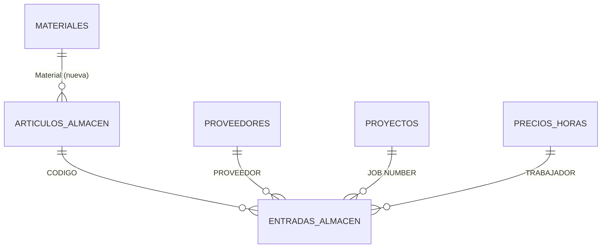

# Estructura de las tablas

Listas de SharePoint **existentes** que usa la app, con sus nombres internos. Las columnas y listas nuevas están en [modelo-datos.md](modelo-datos.md).

PROYECTOS y ENTRADAS ALMACEN se han copiado de `APP TALLER/docs/estructura-tablas.md` (12/11/2026). ARTICULOS ALMACEN, PROVEEDORES y PRECIOS HORAS están pendientes de leer con `scripts/01-Esquema-Listas.ps1` (T-01).

- [ARTICULOS ALMACEN](#articulos-almacen)
- [ENTRADAS ALMACEN](#entradas-almacen)
- [PROVEEDORES](#proveedores)
- [PROYECTOS](#proyectos)
- [PRECIOS HORAS](#precios-horas)
- [Relaciones entre tablas](#relaciones-entre-tablas)

---

## ARTICULOS ALMACEN

Catálogo de artículos. Lo que se sabe por las columnas proyectadas en ENTRADAS ALMACEN:

| Columna (visible) | Nombre interno | Tipo | Notas |
|---|---|---|---|
| CODIGO | pendiente (T-01) | Text | Código del artículo. Lo escribe administración, no sigue ninguna regla y no se cambia (D-3). Ej: `8331412` |
| CONCEPTO | pendiente | | Descripción |
| LUGAR | pendiente | | Ubicación. Ej: `descatalogado`, Jumec, torno, chapero (T-02) |
| MEDIDA | pendiente | | Unidad. Ej: `pcs`, kg, m |
| GRUPO | pendiente | | Ej: `PIEZAS RARAS`, `CONSUMIBLES` |

---

## ENTRADAS ALMACEN

Origen: `ENTRADAS ALMACEN.csv`. **32.018 elementos** en SharePoint (12/11/2026). Movimientos de almacén: entradas de material (compra) y salidas imputadas a un Job.

| Columna (visible) | Nombre interno | Tipo | Req. | Default | Notas |
|---|---|---|---|---|---|
| ID | `ID` | Contador | | | Sistema SharePoint |
| Title | `Title` | Text (255) | | | No se exporta |
| CANTIDAD ENTRADA | `CANTIDAD` | Number | | | |
| PRECIO | `PRECIO` | Number | Sí | | Precio unitario de compra |
| ENTRADA COSTE | — | Calculado (moneda) | | | `CANTIDAD ENTRADA × PRECIO × (1 − DESCUENTO)` |
| Nº FACTURA | `N_x00ba_FACTURA` | Text (255) | | | Factura del proveedor |
| ALBARAN | `ALBARAN` | Text (255) | | | |
| FECHA | `FECHA` | DateTime (solo fecha) | Sí | | |
| CODIGO | — | Lookup → ARTICULOS ALMACEN (`CODIGO`) | | | Ej: `8331412` |
| CODIGO:CONCEPTO | — | Proyectado | | | Descripción del artículo |
| CODIGO:LUGAR | — | Proyectado | | | Ubicación. Ej: `descatalogado` |
| CODIGO:MEDIDA | — | Proyectado | | | Unidad. Ej: `pcs` |
| CODIGO:GRUPO | — | Proyectado | | | Ej: `PIEZAS RARAS`, `CONSUMIBLES` |
| CANTIDAD SALIDA | `CANTIDADSALIDA` | Number | | | |
| PROVEEDOR | — | Lookup → PROVEEDORES (`NOMBRE O RAZÓN SOCIAL`) | | | Ej: `STOCK synergy`, `SUINBAL C.B.` |
| JOB NUMBER | `PROYECTO` | Lookup → PROYECTOS | | | Job al que se imputa la salida. **No indexada** (12/11/2026) |
| PROYECTO:ESTADO | — | Proyectado de PROYECTOS | | | |
| PROYECTO:Descripción | — | Proyectado de PROYECTOS | | | |
| PROYECTO:QW | — | Proyectado de PROYECTOS | | | |
| EXTRA DESCRIPCION | `EXTRADESCRIPCION` | Text (255) | | | |
| DESCUENTO | `DESCUENTO` | Number (%) | | | Descuento de compra |
| coste SY | — | Calculado | | | `PRECIO × (1 − DESCUENTO)` |
| SALIDA COSTE | — | Calculado (moneda) | | | `CANTIDAD SALIDA × coste SY` |
| DESCUENTO VENTA | `DESCUENTO_x0020_VENTA` | Number (%) | | | |
| MARGEN | `Campo1` | Number (%) | | | |
| TRABAJADOR | — | Lookup → PRECIOS HORAS (`NOMBRE`) | | | Ej: `Marco` |
| Modificado | `Modified` | DateTime | | | Sistema SharePoint |

### Observaciones

- La misma fila puede registrar entrada y salida a la vez (`CANTIDAD ENTRADA` y `CANTIDAD SALIDA`).
- `STOCK synergy` se usa como proveedor para el stock propio.
- Nombres internos que no coinciden: CANTIDAD ENTRADA → `CANTIDAD`, MARGEN → `Campo1`.

- Esta lista la comparte App Taller (flujo `TallerTotalesMaterial`). No se cambian columnas existentes.
- Nombres internos de los lookups `CODIGO`, `PROVEEDOR` y `TRABAJADOR`: pendientes (T-01).

---

## PROVEEDORES

Proveedores que facturan. Los datos vienen de Contasimple (T-11).

| Columna (visible) | Nombre interno | Tipo | Notas |
|---|---|---|---|
| NOMBRE O RAZÓN SOCIAL | pendiente (T-01) | Text | Campo que muestra el lookup de ENTRADAS ALMACEN. Incluye `STOCK synergy` |

---

## PROYECTOS

Origen: exportación CSV de la lista SharePoint `PROYECTOS`.

| Columna (visible) | Nombre interno | Tipo | Req. | Default | Notas |
|---|---|---|---|---|---|
| Job | `Job_x0020_` | Text (7) | Sí | | Único e indexado. Ej: `2148`, `S2485` |
| QW | `QW` | Text (255) | | | Cliente / barco |
| Descripción | `Descripci_x00f3_n` | Text (255) | | | |
| TALLER | `Estado` | Text (255) | | `SI` | Valores vistos: `SI`, `NO`, fechas |
| ESTADO | `ESTADO0` | Text (255) | | `NUEVO` | Ej: `FACTURADO`, `GARANTIA` |
| FACTURA | `FACTURA` | Text (255) | | | Nº de factura(s), separadas por `/` |
| CERRADO | `CantidadFacturada` | Text (255) | | | Importe cerrado (guardado como texto) |
| horas estimadas | `H_x002e_Esti` | Number | | | |
| NÚMERO ESTIMATE | `N_x00da_MEROESTIMATE` | Text (255) | | | Ej: `E565112` |
| TARIFA | `IMPORTEESTIMATE` | Number (2 dec.) | | | |
| MARGEN MATERIALES | `MARGENMATERIALES` | Number (%) | | `0.4` | Se exporta como `40,00%` |
| TOTAL ESTIMATE | — | Calculado | | | No aparece en el schema exportado; probablemente campo calculado |
| LABOUR | `LABOUR` | Currency (EUR) | | `0` | |
| MATERIAL | `MATERIAL` | Currency (EUR) | | `0` | |
| ACABADOS | `OTHERS` | Currency (EUR) | | `0` | |
| CONSUMIBLE | `Campo1` | Number (2 dec.) | | `0` | |
| DESCRIPCION FACTURA | `notas` | Note (multilínea) | | | |
| procedencia | `_x0046_13` | Text (255) | | `SALES` | Ej: `ASTILLERO` |
| OPERACION | `_x0046_14` | Text (255) | | | |
| TARIFA GRUPO | `TARIFAGRUPO` | Choice | | `SYNERGY 24` | `SYNERGY 23`, `SYNERGY 24`, `ASTILLERO 23`, `ASTILLERO 24`, `ASTILLERO 25`, `COLABORADOR 24`, `ESPECIAL 24`, `AMIGO 24`, `SUBCONTRATA 23`, `SUBCONTRATA 24`, `SUBCONTRATA 25` |
| MAIL FACTURA | `MAIL_x0020_FACTURA` | Note (multilínea) | | | |
| FACTURACION CLIENTE | `FACTURACION_x0020_CLIENTE` | Note (multilínea) | | | |
| OBSERVACIONES | `OBSERVACIONES` | Note (multilínea) | | | |
| FechaCerrado | `FechaCerrado` | DateTime (solo fecha) | | | |
| Creado | `Created` | DateTime | | | Sistema SharePoint |
| Modificado | `Modified` | DateTime | | | Sistema SharePoint |
| Modificado por | `Editor` | Usuario | | | Sistema SharePoint (email) |
| Datos adjuntos | `Attachments` | Boolean | | | Sistema SharePoint (`0`/`1`) |

### Observaciones

- Varios nombres visibles no coinciden con el interno: TALLER → `Estado`, ESTADO → `ESTADO0`, CERRADO → `CantidadFacturada`, TARIFA → `IMPORTEESTIMATE`, ACABADOS → `OTHERS`, CONSUMIBLE → `Campo1`, DESCRIPCION FACTURA → `notas`.
- Los importes se exportan con formato es-ES (`52.300,00 €`, `40,00%`).
- TOTAL ESTIMATE aparece como `#NULL!` en muchas filas.
- El campo TALLER mezcla valores `SI`/`NO` con fechas.

---

## PRECIOS HORAS

Trabajadores. **La app solo usa `NOMBRE`.** No se copian aquí otras columnas ni datos (DNI, salarios, teléfonos, coste por hora).

| Columna (visible) | Nombre interno | Tipo | Notas |
|---|---|---|---|
| NOMBRE | pendiente (T-01) | Text | Campo que muestra el lookup TRABAJADOR de ENTRADAS ALMACEN |

---

## Relaciones entre tablas

| Desde | Columna | Hacia | Campo destino |
|---|---|---|---|
| ENTRADAS ALMACEN | `CODIGO` | ARTICULOS ALMACEN | `CODIGO` |
| ENTRADAS ALMACEN | `PROVEEDOR` | PROVEEDORES | `NOMBRE O RAZÓN SOCIAL` |
| ENTRADAS ALMACEN | `JOB NUMBER` (`PROYECTO`) | PROYECTOS | `Job` |
| ENTRADAS ALMACEN | `TRABAJADOR` | PRECIOS HORAS | `NOMBRE` |
| ARTICULOS ALMACEN | `Material` (nueva) | MATERIALES | `Title` |
