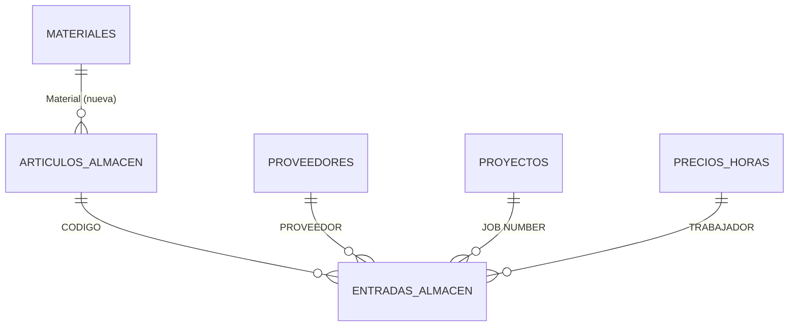

# Estructura de las tablas

Listas de SharePoint **existentes** que usa la app, con sus nombres internos. Las columnas y listas nuevas están en [modelo-datos.md](modelo-datos.md).

PROYECTOS se ha copiado de `APP TALLER/docs/estructura-tablas.md` (12/11/2026). ARTICULOS ALMACEN, ENTRADAS ALMACEN, PROVEEDORES y PRECIOS HORAS se han leído con `scripts/01-Esquema-Listas.ps1` el 21/11/2026.

- [ARTICULOS ALMACEN](#articulos-almacen)
- [ENTRADAS ALMACEN](#entradas-almacen)
- [PROVEEDORES](#proveedores)
- [PROYECTOS](#proyectos)
- [PRECIOS HORAS](#precios-horas)
- [Relaciones entre tablas](#relaciones-entre-tablas)

---

## ARTICULOS ALMACEN

Catálogo de artículos. **4.544 elementos** (21/11/2026). No hay códigos repetidos.

| Columna (visible) | Nombre interno | Tipo | Req. | Indexada | Notas |
|---|---|---|---|---|---|
| ID | `ID` | Contador | | | Sistema SharePoint |
| Title | `Title` | Text | | | Sin uso |
| CODIGO | `CODIGO` | Text | Sí | Sí | Código del artículo. Lo escribe administración, no sigue ninguna regla y no se cambia (D-3). Ej: `8331412` |
| CONCEPTO | `CONCEPTO` | Text | Sí | Sí | Descripción |
| CONCEPTO 2 | `CONCEPTO2` | Note (multilínea) | | | Descripción ampliada |
| LUGAR | **`Campo1`** | Text | | | Ubicación. Ver valores abajo |
| GRUPO | **`LUGAR`** | Text | | | Familia. Ver valores abajo |
| ORIGEN CODIGO | `LUGAR0` | Text | | | |
| MEDIDA | `MEDIDA` | Text | | | Unidad. Ver valores abajo |

Hay además seis columnas que sobraron de una importación (`Tipo de archivo1`, `Id# de instancia de flujo de trabajo1`, `Dirección URL1`, `Ruta de acceso1`, `Tipo de elemento1`, `Dirección URL absoluta codificada1`). La app no las usa.

### Valores en uso (21/11/2026)

**LUGAR (`Campo1`):** vacío 3.296 · `descatalogado` 329 · `ALMACEN 2` 307 · `CANCELADO` 189 · `TORNO` 189 · `chaperos` 149 · `JUMEC` 58 · `13 ESTANTE` 23 · `ESTANTERIA` 3 · `ASTILLEROS` 1.

**GRUPO (`LUGAR`):** `TORNILLERIA` 1.968 · `CONSUMIBLES` 912 · `TUBO` 543 · `PIEZAS RARAS` 325 · `MACIZOS` 239 · `CHAPA` 167 · `HERRAMIENTAS` 151 · `CONSUMIBLE HABITUAL` 77 · `PLETINAS` 63 · `CHAPA OTROS` 40 · `ANGULO` 35 · `SERVICIOS EXTERNOS` 19 · `CONSUMIBLES HABITUAL`, `TRASPASO`, `LASER`, `CHAPA JUMEC`, `CAJAS` 1 cada uno.

**MEDIDA:** `pcs` 3.423 · `kg` 416 · `m` 275 · `MTS` 221 · `kgs` 150 · vacío 24 · `l` 15 · `unidad` 7 · `m2` 5 · `par` 2 · `horas`, `I`, `LTS`, `m3`, `mm`, `psc` 1 cada uno.

### Observaciones

- **Los nombres internos están cruzados:** LUGAR es `Campo1` y GRUPO es `LUGAR`. En fórmulas y flujos se usan siempre los internos.
- LUGAR mezcla ubicaciones con estados (`descatalogado`, `CANCELADO`), y el 73 % de los artículos no tiene lugar (T-02).
- MEDIDA tiene la misma unidad escrita de varias formas: `kg`/`kgs`, `m`/`MTS`, `pcs`/`psc`, `l`/`LTS`/`I` (T-02).
- GRUPO tiene `CONSUMIBLE HABITUAL` y `CONSUMIBLES HABITUAL` (T-02).
- Con más de 2.000 artículos, la app no los puede cargar de una vez en una colección (ver [modelo-datos.md](modelo-datos.md#rendimiento-y-delegación)).

---

## ENTRADAS ALMACEN

**32.250 elementos** (21/11/2026). Movimientos de almacén: entradas de material (compra) y salidas imputadas a un Job.

| Columna (visible) | Nombre interno | Tipo | Req. | Default | Notas |
|---|---|---|---|---|---|
| ID | `ID` | Contador | | | Sistema SharePoint |
| Title | `Title` | Text (255) | | | No se exporta |
| CANTIDAD ENTRADA | `CANTIDAD` | Number | | | |
| PRECIO | `PRECIO` | Number | Sí | | Precio unitario de compra |
| ENTRADA COSTE | `TOTAL_x0020_COSTE` | Calculado (moneda) | | | `CANTIDAD ENTRADA × PRECIO × (1 − DESCUENTO)` |
| Nº FACTURA | `N_x00ba_FACTURA` | Text (255) | | | Factura del proveedor |
| ALBARAN | `ALBARAN` | Text (255) | | | |
| FECHA | `FECHA` | DateTime (solo fecha) | Sí | | |
| CODIGO | `CODIGO` | Lookup → ARTICULOS ALMACEN (`CODIGO`) | | | Ej: `8331412`. **No indexada** (T-08) |
| CODIGO:CONCEPTO | `CODIGO_x003a_CONCEPTO` | Proyectado (`CONCEPTO`) | | | Descripción del artículo |
| CODIGO:LUGAR | `CODIGO_x003a_LUGAR` | Proyectado (`Campo1`) | | | Ubicación. Ej: `descatalogado` |
| CODIGO:MEDIDA | `CODIGO_x003a_MEDIDA` | Proyectado (`MEDIDA`) | | | Unidad. Ej: `pcs` |
| CODIGO:GRUPO | `CODIGO_x003a_GRUPO` | Proyectado (`LUGAR`) | | | Ej: `PIEZAS RARAS`, `CONSUMIBLES` |
| CANTIDAD SALIDA | `CANTIDADSALIDA` | Number | | | |
| PROVEEDOR | `PROVEEDOR` | Lookup → PROVEEDORES (`NOMBRE_x0020_O_x0020_RAZ_x00d3_N`) | Sí | | Ej: `STOCK synergy`, `SUINBAL C.B.`. **No indexada** (T-08) |
| JOB NUMBER | `PROYECTO` | Lookup → PROYECTOS (`Job_x0020_`) | | | Job al que se imputa la salida. Indexada |
| PROYECTO:ESTADO | `PROYECTO_x003a_ESTADO` | Proyectado (`ESTADO0`) | | | |
| PROYECTO:Descripción | `PROYECTO_x003a_Descripci_x00f3_n` | Proyectado (`Descripci_x00f3_n`) | | | |
| PROYECTO:QW | `PROYECTO_x003a_QW` | Proyectado (`QW`) | | | |
| EXTRA DESCRIPCION | `EXTRADESCRIPCION` | Text (255) | | | |
| DESCUENTO | `DESCUENTO` | Number (%) | | | Descuento de compra |
| coste SY | `coste_x0020_SY` | Calculado | | | `PRECIO × (1 − DESCUENTO)` |
| SALIDA COSTE | `SALIDA_x0020_COSTE` | Calculado (moneda) | | | `CANTIDAD SALIDA × coste SY` |
| DESCUENTO VENTA | `DESCUENTO_x0020_VENTA` | Number (%) | | | |
| MARGEN | `Campo1` | Number (%) | | | |
| TRABAJADOR | `TRABAJADOR` | Lookup → PRECIOS HORAS (`NOMBRE`) | | | Ej: `Marco` |
| Modificado | `Modified` | DateTime | | | Sistema SharePoint |

### Observaciones

- La misma fila puede registrar entrada y salida a la vez (`CANTIDAD ENTRADA` y `CANTIDAD SALIDA`).
- `STOCK synergy` se usa como proveedor para el stock propio.
- Nombres internos que no coinciden: CANTIDAD ENTRADA → `CANTIDAD`, ENTRADA COSTE → `TOTAL_x0020_COSTE`, MARGEN → `Campo1`, JOB NUMBER → `PROYECTO`.
- Los lookups `CODIGO`, `PROVEEDOR` y `TRABAJADOR` tienen el mismo nombre interno que el visible.
- Esta lista la comparte App Taller (flujo `TallerTotalesMaterial`). No se cambian columnas existentes.
- Solo está indexada `PROYECTO`. Faltan `CODIGO` y `PROVEEDOR` (T-08).

---

## PROVEEDORES

Proveedores que facturan. **855 elementos** (21/11/2026). Los datos vienen de Contasimple (T-11). Ninguna columna es obligatoria ni está indexada.

| Columna (visible) | Nombre interno | Tipo | Notas |
|---|---|---|---|
| NOMBRE O RAZÓN SOCIAL | `NOMBRE_x0020_O_x0020_RAZ_x00d3_N` | Text | Campo que muestra el lookup de ENTRADAS ALMACEN. `STOCK synergy` es el ID 626 |
| % DESCUENTO POR DEFECTO | `_x0025__x0020_DESCUENTO_x0020_PO` | Number | Podría proponer el descuento de la entrada. En Power Automate es `OData__x0025__x0020_DESCUENTO_x0020_PO` |
| EMAIL | `EMAIL` | Text | |
| TELF. | `TELF_x002e_` | Text | |
| FAX | `FAX` | Number | |
| DIRECCIÓN | `DIRECCI_x00d3_N` | Text | |
| COD. POSTAL | `COD_x002e__x0020_POSTAL` | Text | |
| POBLACIÓN | `POBLACI_x00d3_N` | Text | |
| PROVINCIA | `PROVINCIA` | Text | |
| PAÍS | `PA_x00cd_S` | Text | |
| URL | `URL` | Text | |
| LATITUD / LONGITUD | `LATITUD` / `LONGITUD` | Number | |
| Personalizado1 / Personalizado2 | `Personalizado1` / `Personalizado2` | Text | |
| NOTAS | `NOTAS` | Text | |
| CUENTAS BANCARIAS | `CUENTAS_x0020_BANCARIAS` | Number | |

La app solo usa `ID` y `NOMBRE_x0020_O_x0020_RAZ_x00d3_N` (y quizá el descuento por defecto). Con 855 filas cabe en una colección.

---

## PROYECTOS

Origen: exportación CSV de la lista SharePoint `PROYECTOS`.

| Columna (visible) | Nombre interno | Tipo | Req. | Default | Notas |
|---|---|---|---|---|---|
| Job | `Job_x0020_` | Text (7) | Sí | | Único e indexado. Ej: `2148`, `S2485` |
| QW | `QW` | Text (255) | | | Cliente / barco |
| Descripción | `Descripci_x00f3_n` | Text (255) | | | |
| TALLER | `Estado` | Text (255) | | `SI` | Valores vistos: `SI`, `NO`, fechas |
| ESTADO | `ESTADO0` | Text (255) | | `NUEVO` | Ej: `FACTURADO`, `GARANTIA` |
| FACTURA | `FACTURA` | Text (255) | | | Nº de factura(s), separadas por `/` |
| CERRADO | `CantidadFacturada` | Text (255) | | | Importe cerrado (guardado como texto) |
| horas estimadas | `H_x002e_Esti` | Number | | | |
| NÚMERO ESTIMATE | `N_x00da_MEROESTIMATE` | Text (255) | | | Ej: `E565112` |
| TARIFA | `IMPORTEESTIMATE` | Number (2 dec.) | | | |
| MARGEN MATERIALES | `MARGENMATERIALES` | Number (%) | | `0.4` | Se exporta como `40,00%` |
| TOTAL ESTIMATE | — | Calculado | | | No aparece en el schema exportado; probablemente campo calculado |
| LABOUR | `LABOUR` | Currency (EUR) | | `0` | |
| MATERIAL | `MATERIAL` | Currency (EUR) | | `0` | |
| ACABADOS | `OTHERS` | Currency (EUR) | | `0` | |
| CONSUMIBLE | `Campo1` | Number (2 dec.) | | `0` | |
| DESCRIPCION FACTURA | `notas` | Note (multilínea) | | | |
| procedencia | `_x0046_13` | Text (255) | | `SALES` | Ej: `ASTILLERO` |
| OPERACION | `_x0046_14` | Text (255) | | | |
| TARIFA GRUPO | `TARIFAGRUPO` | Choice | | `SYNERGY 24` | `SYNERGY 23`, `SYNERGY 24`, `ASTILLERO 23`, `ASTILLERO 24`, `ASTILLERO 25`, `COLABORADOR 24`, `ESPECIAL 24`, `AMIGO 24`, `SUBCONTRATA 23`, `SUBCONTRATA 24`, `SUBCONTRATA 25` |
| MAIL FACTURA | `MAIL_x0020_FACTURA` | Note (multilínea) | | | |
| FACTURACION CLIENTE | `FACTURACION_x0020_CLIENTE` | Note (multilínea) | | | |
| OBSERVACIONES | `OBSERVACIONES` | Note (multilínea) | | | |
| FechaCerrado | `FechaCerrado` | DateTime (solo fecha) | | | |
| Creado | `Created` | DateTime | | | Sistema SharePoint |
| Modificado | `Modified` | DateTime | | | Sistema SharePoint |
| Modificado por | `Editor` | Usuario | | | Sistema SharePoint (email) |
| Datos adjuntos | `Attachments` | Boolean | | | Sistema SharePoint (`0`/`1`) |

### Observaciones

- Varios nombres visibles no coinciden con el interno: TALLER → `Estado`, ESTADO → `ESTADO0`, CERRADO → `CantidadFacturada`, TARIFA → `IMPORTEESTIMATE`, ACABADOS → `OTHERS`, CONSUMIBLE → `Campo1`, DESCRIPCION FACTURA → `notas`.
- Los importes se exportan con formato es-ES (`52.300,00 €`, `40,00%`).
- TOTAL ESTIMATE aparece como `#NULL!` en muchas filas.
- El campo TALLER mezcla valores `SI`/`NO` con fechas.

---

## PRECIOS HORAS

Trabajadores. **161 elementos** (21/11/2026). **La app solo usa `NOMBRE`.** No se copian aquí otras columnas ni datos (DNI, salarios, teléfonos, coste por hora).

| Columna (visible) | Nombre interno | Tipo | Notas |
|---|---|---|---|
| NOMBRE | `NOMBRE` | Text | Campo que muestra el lookup TRABAJADOR de ENTRADAS ALMACEN |

---

## Relaciones entre tablas

| Desde | Columna | Hacia | Campo destino |
|---|---|---|---|
| ENTRADAS ALMACEN | `CODIGO` | ARTICULOS ALMACEN | `CODIGO` |
| ENTRADAS ALMACEN | `PROVEEDOR` | PROVEEDORES | `NOMBRE_x0020_O_x0020_RAZ_x00d3_N` |
| ENTRADAS ALMACEN | `JOB NUMBER` (`PROYECTO`) | PROYECTOS | `Job_x0020_` |
| ENTRADAS ALMACEN | `TRABAJADOR` | PRECIOS HORAS | `NOMBRE` |
| ARTICULOS ALMACEN | `Material` (nueva) | MATERIALES | `Title` |
