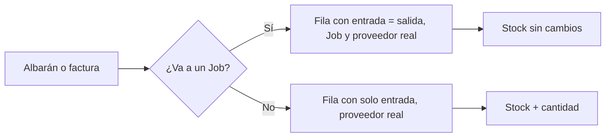
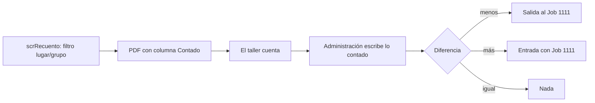
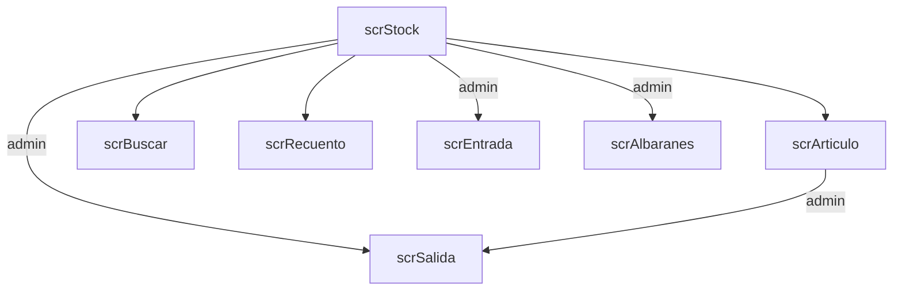

# Flujos y navegación

Procesos del almacén y pantallas de la app. Las columnas que se escriben en cada caso están en [modelo-datos.md](modelo-datos.md#qué-escribe-la-app-en-entradas-almacen).

## Procesos

### Entrada (albarán o factura)

### Albarán → factura

1. Se mete el albarán: filas con `ALBARAN` y sin `N_x00ba_FACTURA`.
2. Llega la factura y se contabiliza en Contasimple.
3. En `scrAlbaranes` se elige el proveedor, se marcan sus albaranes pendientes y se escribe el nº de factura (D-10).
4. Si la factura trae artículos sin albarán, se meten como entrada nueva con el nº de factura.

### Salida desde el stock

1. Se elige el artículo; la app propone el último precio y `STOCK synergy`.
2. Se elige el Job. Si `ESTADO0 <> ABIERTO`, avisa y pide confirmación (D-6).
3. Se escribe la cantidad (o, en planchas y macizos, la medida, y la app calcula los kg).
4. Si el stock resultante es ≤ mínimo o ≤ 0, avisa (D-1). Se puede guardar igualmente.

### Recuento y regularización

Antes de regularizar hay que esperar a que el flujo StockTotales haya recalculado (`FechaStock` posterior a la última fila del artículo). Si no, la diferencia se calcula sobre un stock viejo (T-13).

### Recálculo del stock (flujo StockTotales, D-15)

- **`StockTotalesArticulo`**: flujo secundario que recalcula un artículo. Lo llaman los otros flujos y, más adelante, la app antes de regularizar (T-13).
- **`StockTotalesMovimiento`**: se dispara al crear o modificar una fila de ENTRADAS ALMACEN y recalcula el artículo de esa fila. Si la modificación cambia el artículo, el anterior queda pendiente hasta el siguiente recálculo completo.
- **Recálculo completo**: recoge los borrados y los cambios de artículo. No puede ser un flujo nocturno sobre los 4.544 artículos, porque superaría el límite diario de solicitudes de Microsoft 365. Falta decidir cómo se hace (T-15). Para las pruebas está `StockTotalesLote`, que se lanza a mano.

La guía para montarlos está en [stock/flujo-StockTotales.md](../stock/flujo-StockTotales.md).

## Pantallas

| Pantalla | Qué hace | Perfil |
|---|---|---|
| `scrStock` | Inicio: stock con filtros, resumen por lugar y avisos | Todos |
| `scrArticulo` | Ficha, historial de compras, salidas y calculadora kg ↔ medida. Alta y edición | Ver: todos · Editar: admin |
| `scrEntrada` | Albarán o factura con varias filas | Admin |
| `scrSalida` | Salida desde el stock | Admin |
| `scrAlbaranes` | Asignar el nº de factura a albaranes | Admin |
| `scrBuscar` | Movimientos por proveedor o por Job | Todos |
| `scrRecuento` | Filtros, PDF y regularización | PDF: todos · Regularizar: admin |

Los botones de administración no aparecen si el usuario no está en `ADMIN ALMACEN` (`nfEsAdmin`, D-5).
